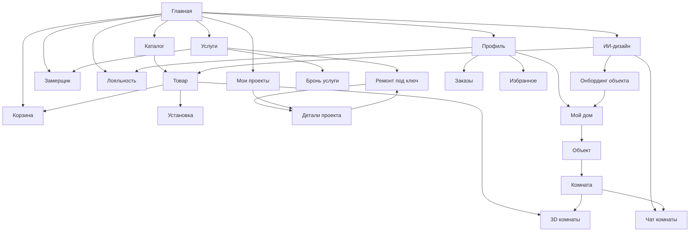

# ОМА. Дом — Flutter

Клиент к backend [oma_be](https://github.com/evander006/oma_be).

Русский UI, цены в **BYN**. Каркас приложения — телефонный layout (max width 430).

## API

По умолчанию приложение ходит на hosted instance:

**https://oma-be-85l2.onrender.com**

Swagger: https://oma-be-85l2.onrender.com/docs

```bash
# другой хост (локальный uvicorn / LAN)
flutter run --dart-define=API_BASE_URL=http://10.0.2.2:8000

# офлайн mock без сети
flutter run --dart-define=USE_MOCK_API=true
```

Конфиг: `lib/core/network/api_config.dart`.

## Что подключено к oma_be

| Область | Endpoint |
|---------|----------|
| Каталог / категории / карточка / 3D meta | `/products`, `/categories`, assets |
| Корзина / избранное / заказы | `/cart`, `/favorites`, `/orders` |
| Услуги установки (товар) | `/installation-services` |
| ИИ-чат и рекомендации | `/ai/chat`, `/ai/recommendations` |
| Услуги ремонта | `/renovation/services` |
| Заявки на установку | `/renovation/installation-requests` |
| Проекты ремонта под ключ | `/renovation/projects`, `/renovation/requests` |
| Лояльность | `/loyalty/account`, `/rewards`, `/transactions` |
| Профиль | `/me` |
| Мой дом: объекты / комнаты | `/properties`, `/rooms`, photos, placements |

Черновики мастера «Ремонт под ключ» хранятся локально до «Отправить заявку», затем создаются на backend.

«Мой дом»: объекты и комнаты через API; локальный overlay хранит выбор объекта, area/budget и список items.

## Запуск

```bash
flutter pub get
flutter run
flutter test
flutter analyze --no-fatal-infos
```

---

## Дизайн-концепт

**Идея:** светлое retail / DIY-приложение для дома и ремонта (бренд ОМА): холодный серый холст, белые карточки с тонкой обводкой, синий как основной акцент, оранжевый как второй. Ориентир по главной — Figma «ОМА. Дом» (фрейм «Главная», node `160:3283`).

| Роль | Значение |
|------|----------|
| Фон | `#F4F6F8` |
| Текст (ink) | `#172F40` |
| Приглушённый | `#607482` |
| Primary (синий ОМА) | `#0065AE` |
| Hero / deep blue | `#073D66` |
| Soft blue (карточки прогресса, лояльность) | `#EAF3FA` |
| Secondary / акцент | `#FB981E` |
| Линии | `#DCE4E9` |
| Корзина (CTA-иконка) | `#E53935` |
| Шрифт | Inter (`OmaType`: regular / medium / semibold / bold) |
| Скругления | 4 → 8 → 12 → 14 → 20, pill 100 |
| Тема | Material 3, только light |

Паттерны UI: `OmaPage` + header, белые surface-карточки, section titles 20px bold, нижняя навигация с активным табом в синем. На главной текстовые CTA «Рассчитать стоимость» заменены на **красную иконку корзины**.

---

## Навигация (каркас)

Пять вкладок в `StatefulShell` (`OmaShell` + `OmaBottomNav`):

| Вкладка | Маршрут | Экран |
|---------|---------|--------|
| Главная | `/` | Home |
| Каталог | `/catalog` | Catalog |
| Услуги | `/services` | Services hub |
| Мои проекты | `/projects` | Projects |
| Профиль | `/profile` | Profile |

Повторный тап по активной вкладке сбрасывает её к корню ветки.

**Вне shell** (отдельный стек, чтобы не ломать Navigator/Hero): корзина, избранное, онбординг, ИИ-дизайн, чат комнаты, 3D комнаты, карточка товара и установка, мастер «под ключ», замерщик, бронь услуги, детали проекта.

---

## Userflow — что есть сейчас

### 0. Старт

1. Приложение открывается на **Главной** (`/`).
2. Онбординг объекта не обязателен при старте: его запускают из профиля / пустого «Мой дом» / ИИ-дизайна / проектов.

### 1. Главная

Шапка: «‹ Город» → **Мой дом**; логотип; колокольчик (заглушка); **красная корзина** → `/cart`.

Дальше по экрану (типичные тапы):

| Элемент | Куда |
|---------|------|
| Поиск | Каталог |
| Hero «Ремонт под ключ» / красная корзина в блоке | Корзина (иконка) · сценарий ремонта — через чипы/услуги |
| «Отдельные ремонтные работы» | Услуги |
| «ИИ-дизайнер по фото» | `/ai-design` |
| «Подбор материалов» | Каталог |
| «Вызвать замерщика» | `/services/measurer` |
| Чипы «С чего начнём?» | turnkey / AI / каталог |
| Карточка активного проекта | `/projects/:id` |
| Популярные услуги / «Все услуги» | бронь услуги или хаб услуг |
| Материалы / «Для кухни…» / комплект комнаты / сезон | Каталог |
| Лояльность | `/profile/loyalty` |

### 2. Каталог → товар → корзина / установка

```
Каталог (поиск, категории)
  → карточка товара (/product/:id)
       → избранное (toggle API)
       → в корзину
       → заказать установку → /product/:id/install (6 шагов)
       → блок 3D товара (метаданные GLB / заглушка)
       → при наличии комнаты: «в комнате» → /room/.../3d
Корзина (/cart)
  → демо-оформление → заказы (/profile/orders)
Избранное (/favorites) — из профиля
```

Оплаты нет: checkout демонстрационный.

### 3. Услуги

```
Хаб /services
  ├─ Ремонт под ключ → /services/turnkey
  ├─ Вызвать замерщика → /services/measurer
  └─ Список отдельных работ → /services/book/:serviceId
```

**Ремонт под ключ** (мастер, ~10 шагов):  
тип объекта → тип ремонта → параметры → комнаты/работы → фото/план → стиль → бюджет/сроки → материалы → контакты → сводка → отправка.  
Черновик локальный; после отправки — проект на backend и переход в `/projects/:id`. Продолжение черновика: `/services/turnkey/:requestId`.

**Замерщик:** форма (адрес, телефон, слот) → локальный id заявки (удалённый endpoint замера пока не обязателен).

**Бронь услуги:** комната/объём → фото → контакты/дата → подтверждение.

**Установка товара** (из карточки): состав → адрес → слот → сводка → успех → заказы / главная.

### 4. ИИ-дизайн и чат комнаты

```
/ai-design (шаги в одном экране)
  объект → комната/фото → стиль/бюджет → категории
  → проверка → рекомендации (API + каталог)
  → открыть товар / чат комнаты / создать объект (онбординг)

/ai/room/:propertyId/:roomId
  чат по комнате (подбор товаров)
  → карточки товаров → /product/:id
```

Открывается с главной, из проектов, из экрана комнаты, из «недостающих» позиций.

### 5. Мой дом (объекты и комнаты)

```
Профиль или «‹ Город» / онбординг
  → /profile/my-home (список объектов)
       → объект /profile/property/:id
            → редактирование
            → планировка (комнаты)
            → комната /.../room/:roomId
                 ├─ редактировать комнату
                 ├─ ИИ-чат
                 ├─ 3D примерка (/room/.../3d)
                 ├─ покупки комнаты
                 ├─ недостающее
                 └─ предложения к заполнению
```

**Онбординг нового объекта:**  
Welcome → жильё → фото → потребности → черновик готов → Мой дом / профиль.  
«Пропустить» → профиль. Создаёт объект через `PropertiesCubit` (+ API properties/rooms).

**3D комнаты:** интерактивная Three.js-сцена во встроенном WebView на Android/iOS и в веб-версии. Android Companion включает сам редактор и использует полный импортированный SQLite-каталог ОМА: поиск, пагинация, добавление нескольких одинаковых предметов, перетаскивание, поворот и удаление; черновик расстановки сохраняется локально на устройстве. Flutter/web-сценарий сохраняет расстановку через backend API. Предварительные товары не считаются покупкой, а купленные товары отображаются отдельным слоем. Если точной GLB-модели производителя нет, используется процедурное приближение.

### 6. Мои проекты

```
/projects
  список заявок на ремонт
  → /projects/:id (статус, детали, продолжить черновик turnkey)
  CTA: новый turnkey / ИИ-дизайн / Мой дом
```

### 7. Профиль и лояльность

```
/profile
  ├─ Мой дом
  ├─ Мои проекты
  ├─ Бонусная программа → /profile/loyalty
  ├─ Корзина / Заказы / Избранное
  ├─ Адреса (через объекты)
  └─ заглушки: уведомления, privacy, удаление аккаунта
```

Лояльность: баланс, tier, награды/история с `/loyalty/*` (пометка демо, если backend demo).

---

## Схема переходов (кратко)



---

## Заметки по границам продукта

- Нет реальной оплаты и auth: демо-заказ, демо-лояльность где помечено backend.
- `aiDesignResults` как отдельный route объявлен, но результаты живут внутри шагов `/ai-design`.
- Route `.../saved` для комнаты есть в роутере; отдельного явного CTA в UI может не быть.
- Замерщик и часть черновиков могут работать локально, если remote endpoint недоступен.
- ИИ и каталог завязаны на oma_be; при `USE_MOCK_API=true` — mock-данные без сети.
